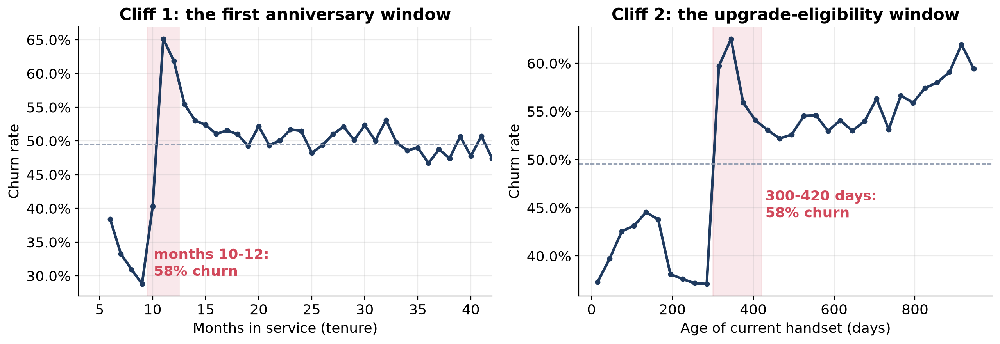
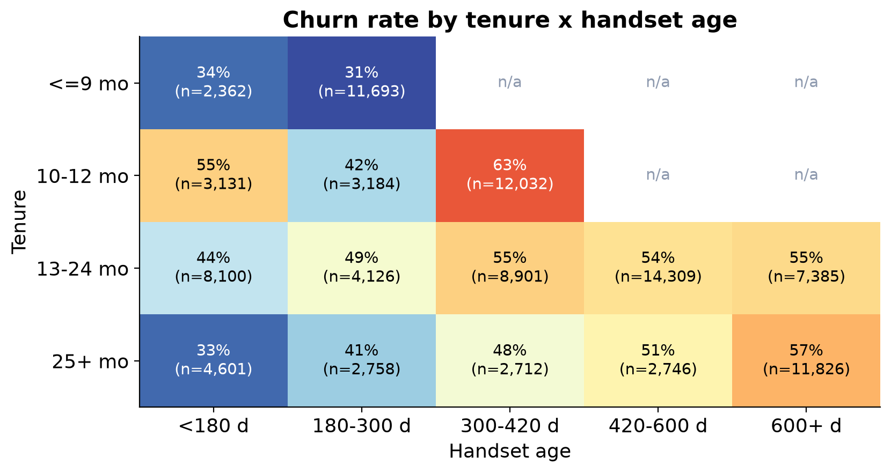
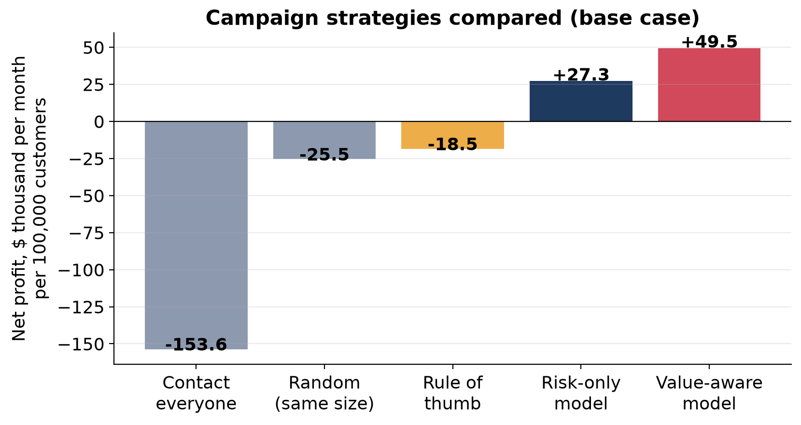
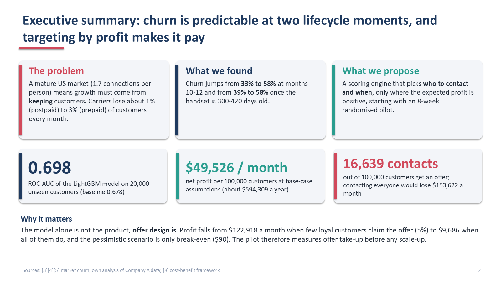
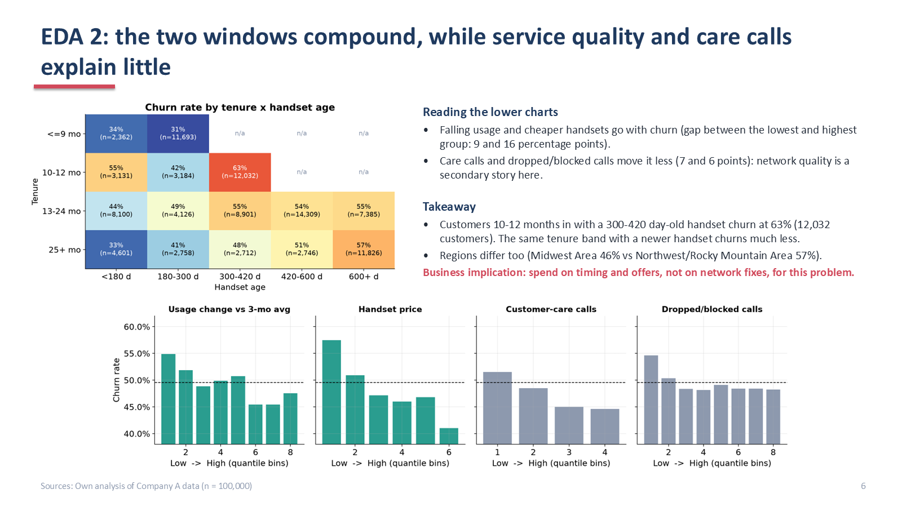
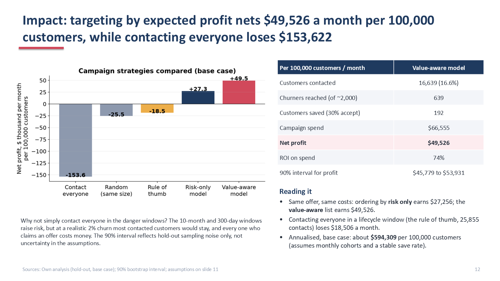

# Profit-Targeted Churn Retention

> Ranking customers by **expected profit** instead of churn risk alone turns a retention campaign that loses **$153,622 a month** (contact everyone) into one that earns **$49,526 a month** per 100,000 customers.

An end-to-end machine learning project for a US wireless carrier ("Company A"): exploratory analysis, a tuned gradient-boosting churn model, and a cost-benefit layer that decides who to contact. Built for the GCI World 2026 Winter final assignment (Matsuo-Iwasawa Lab, The University of Tokyo).

**Tech stack:** Python, pandas, scikit-learn, LightGBM, XGBoost, matplotlib, python-pptx.
**Category:** applied machine learning (supervised binary classification) with profit-driven, cost-sensitive decision analytics for customer retention.

**Notebook:** [`churn_retention_analysis.ipynb`](churn_retention_analysis.ipynb) (executed, with all outputs and charts) | **Slides:** [`slides/Profit-Targeted_Churn_Retention.pdf`](slides/Profit-Targeted_Churn_Retention.pdf)

## The question

Which customers are about to leave, when are they most at risk, and how should a limited retention budget be spent so that the campaign actually makes money?

## Key results

| Item | Result |
|---|---|
| Model | LightGBM (tuned), tied with tuned XGBoost |
| Metric | ROC-AUC on a 20,000-customer hold-out: **0.698** (95% bootstrap interval 0.691 to 0.705) |
| Baseline | Default XGBoost on raw columns: 0.678 |
| Lift | Top 10% of risk scores contain 1.6x more churners than average |
| Churn cliff | Churn rises from 33% (months 5-8) to 58% (months 10-12). The hot spot is customers at their first anniversary on the original handset: 63% churn (12,032 customers) |
| Campaign (base case, per 100,000 customers per month) | 16,639 contacts, net profit **$49,526**, ROI 74% |
| Alternatives | Risk-only targeting: $27,256. Rule of thumb (everyone in a lifecycle window): -$18,506. Contact everyone: -$153,622 |
| Pessimistic scenario | About break-even ($90 a month) |





## What makes this different

1. **A lifecycle finding, not just a score.** Churn clusters in two predictable windows (first anniversary and handset age of about 300 to 420 days), and these are largely the same group of customers. That tells the business when to act, not only whom to rank.
2. **Profit-based targeting.** Each customer is contacted only if the expected gain is positive, using the cost-benefit framework of Verbraken, Verbeke and Baesens (2013). High-revenue customers justify a larger outreach list than low-revenue ones.
3. **Honest handling of an over-sampled dataset.** The training sample is about 50% churners, while real monthly churn is about 2%. Probabilities are calibrated (Platt scaling) and re-weighted with Bayes' rule before any money figure is computed.
4. **Sensitivity instead of a single number.** Profit is shown across offer leakage, offer acceptance, true churn rate and customer value horizon, so the reader can see which assumptions matter.

## Approach

1. **EDA:** two lifecycle cliffs, a tenure by handset-age heatmap, weaker signals (usage change, handset price, call quality).
2. **Features:** 98 raw columns to 113 features (usage trends, failure rates, handset age relative to tenure, overage share, count of missing demographics).
3. **Models:** logistic regression, random forest, XGBoost, LightGBM and a blend. 80/20 stratified hold-out plus 5-fold cross-validation with early-stopped tuning.
4. **Money:** calibrated, re-weighted probabilities feed an expected-gain rule per customer.
5. **Sensitivity and scenarios:** pessimistic, base and upside cases.

## Limitations and next steps

- The model is moderate (AUC about 0.70), which is typical for behavioural telecom data. The proposal does not rely on a perfect model, because it contacts only customers where the numbers clearly pay.
- Profit depends on offer design: how many loyal customers also claim the offer, and the real save rate. Both are assumptions here.
- The 10-12 month and 300-day pattern may be a contract effect or partly a feature of how the sample was drawn. Correlation is not causation.
- The 90% interval on profit reflects hold-out sampling noise only, not uncertainty in the assumptions.
- **Next step:** an 8-week randomised pilot (50% offer, 50% hold-out) to measure the true save rate and offer leakage, then uplift modelling.

## Slide previews





## Repository contents

| Path | What it is |
|---|---|
| `churn_retention_analysis.ipynb` | Executed notebook with all analysis, charts and results |
| `analysis.py` | The same analysis as a script (percent-format cells) |
| `make_nb.py` | Converts `analysis.py` into a notebook |
| `build_deck.py` | Builds the 15-slide deck from `outputs/` |
| `outputs/results.json` | Every number used on the slides |
| `outputs/figs/` | Charts |
| `slides/` | The final presentation (PDF) and slide previews |

## Data

The Company A dataset (`Client.csv`, `Record.csv`) belongs to the course and is **not** included. To reproduce the results, place the two files in a folder called `telecom/` next to the notebook.

## Reproduce

```bash
pip install numpy pandas matplotlib scikit-learn lightgbm xgboost python-pptx nbformat nbconvert
python analysis.py                              # about 1 hour on a laptop CPU; set FAST=1 for a quick check
python make_nb.py churn_retention_analysis      # optional: rebuild the notebook
python build_deck.py                            # optional: rebuild the slides
```

## References

Market data come from CTIA, T-Mobile, Verizon, AT&T and Light Reading. Method references are Verbraken et al. (2013), LightGBM, XGBoost and scikit-learn. The full numbered list with links is on the last slide of `slides/Profit-Targeted_Churn_Retention.pdf`.

## Author

Raymond Klanderman ([rayklanderman](https://github.com/rayklanderman), also [RealDevRay](https://github.com/RealDevRay)).

